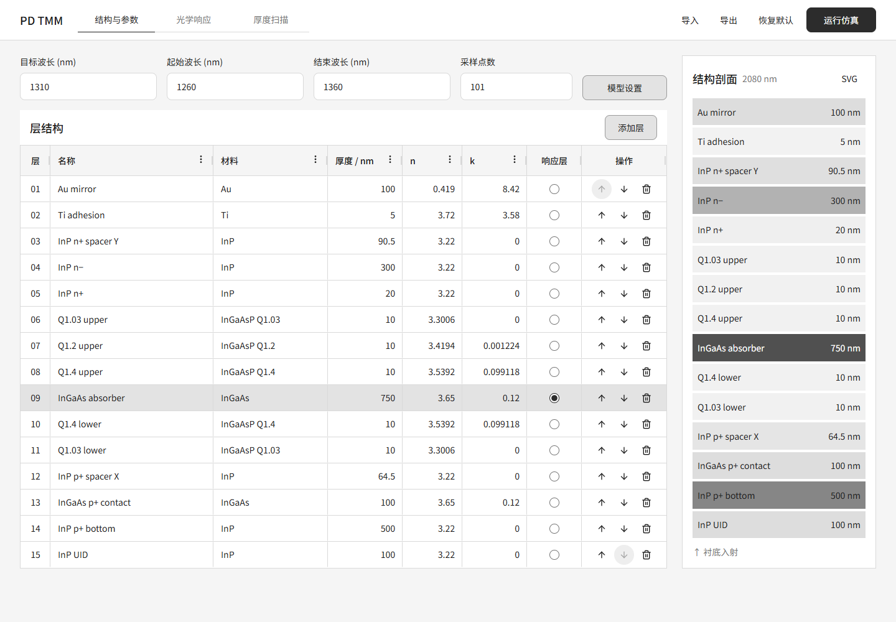

# PD TMM Studio

光电探测器外延结构的光学仿真工作台，可编辑层结构、查看光谱响应，以及扫描单层或双层厚度。

[使用说明](docs/usage.md) · [开发说明](docs/development.md) · [界面设计](docs/design.md) · [配色](docs/color-research.md)



## 快速开始

安装 Node.js 20 或更高版本，在项目目录运行：

```sh
npm start
```

打开 [本地工作台](http://127.0.0.1:4173/)，修改参数后点击「运行仿真」；停止服务时按 `Ctrl+C`。

前端依赖已随源码保存，直接运行无需安装依赖，也可以使用 `node scripts/serve.mjs` 启动。
计算和文件读取都在浏览器中完成，本地服务只提供页面文件；请通过上述地址打开，不要直接双击 HTML。

## 功能

| 工作区 | 用途 |
| --- | --- |
| 结构与参数 | 编辑材料、厚度和 n/k，选择响应层，调整层序，查看结构剖面 |
| 光学响应 | 查看吸收率、响应度、光谱和归一化场强，导出 CSV 或 SVG |
| 厚度扫描 | 扫描一层的响应曲线，或两层的响应热图，查看采样范围内的最优值 |

页面打开时不自动计算，修改参数后需要重新运行。
编辑内容不会自动保存，刷新会恢复配置中的初始值；结构 JSON 只保存层结构，具体字段见 [导入与导出](docs/usage.md#导入与导出)。

## 开发

安装开发依赖后，运行格式检查和计算回归检查：

```sh
npm ci
npm run format:check
npm test
```

项目使用原生 HTML、CSS 和 JavaScript，表格采用 AG Grid Community，图标采用 Lucide。
常用参数、配色和布局的修改位置见 [开发说明](docs/development.md)。

静态部署只需上传 `index.html` 和 `src/`，目录结构保持不变，无需构建。

## 来源

从 `lu33833/lu33833.github.io` 的 `tools/pd-tmm-studio` 提取，保留原计算模型，独立维护界面。
来源提交及回归检查见 [计算核心](docs/development.md#计算核心)，第三方组件许可证见 [vendor-licenses.txt](docs/vendor-licenses.txt)。
